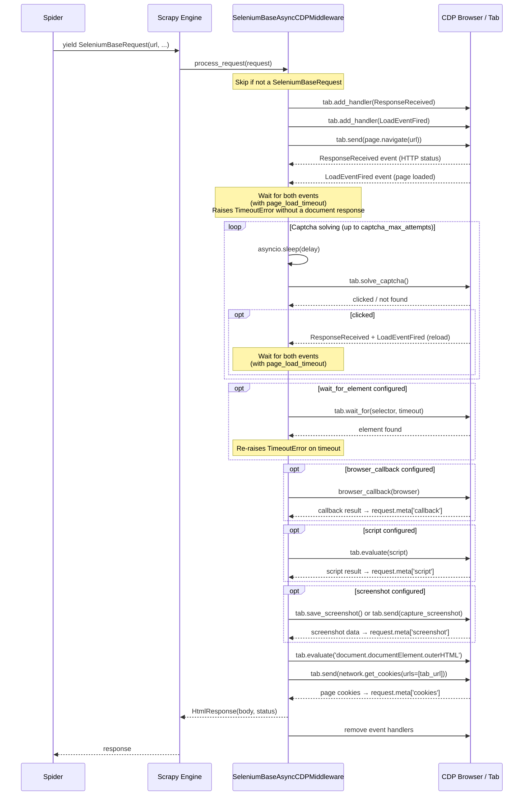

# Architecture

This document describes the internal architecture of `scrapy-seleniumbase-cdp`,
a Scrapy downloader middleware that uses SeleniumBase's pure CDP (Chrome
DevTools Protocol) mode to process requests.

## Request processing sequence

The following diagram shows what happens when the middleware processes a
`SeleniumBaseRequest`:

## Components

### `SeleniumBaseRequest` (`request.py`)

A subclass of Scrapy's `Request` that carries additional configuration for the
middleware. It accepts the following kwargs beyond the standard Scrapy ones:

- **`page_load_timeout`** — seconds to wait for both the HTTP response and page
  load events.
- **`captcha_delay`** / **`captcha_blocked_delay`** — seconds to wait before each captcha solve attempt, for a status outside / inside `captcha_blocked_codes`.
- **`captcha_blocked_codes`** — HTTP status codes that trigger the blocked
  delay.
- **`captcha_max_attempts`** — maximum number of captcha solve attempts.
- **`captcha_only_when_blocked`** — attempt captcha solving only when the page loads with a status in `captcha_blocked_codes`.
- **`wait_for_element`** / **`element_timeout`** — CSS selector and timeout for
  waiting on a specific DOM element.
- **`browser_callback`** — an async callback receiving the `Browser` instance.
- **`script`** — JavaScript code to execute on the page.
- **`screenshot`** — screenshot configuration (format, full page, save path).

The `script` argument is normalised to a `ScriptConfig` `TypedDict` via a
`match`/`case` statement. `screenshot=True` is coerced to
`{'format': 'png', 'full_page': True}`.

### `SeleniumBaseAsyncCDPMiddleware` (`middleware_async.py`)

The async Scrapy downloader middleware. It maintains a single shared `Browser`
instance for the lifetime of the spider.

#### Lifecycle

1. **`spider_opened`** — starts the CDP browser via `cdp_driver.start_async(**browser_options)`, then calls `browser.get('about:blank')` once and keeps the tab it returns as the request tab. `Browser.get` applies the settings SeleniumBase keeps in `sb_config` (user agent, locale, timezone, ad block, …) to the tab it navigates, which is `browser.targets[-1]`: the most recent target, of any type. Called per request, it would navigate a tab opened later by a `browser_callback` or a popup, while the handlers listen on another one. The settings are per-tab CDP overrides, so they stay on the request tab, which each request navigates itself with `Page.navigate`.
2. **`process_request`** — intercepts `SeleniumBaseRequest` instances and
   delegates to the processing pipeline (see diagram above). Regular
   `Request` objects are passed through by returning `None`.
3. **`spider_closed`** — stops the browser.

#### Event-driven page load

After sending `Page.navigate` to the request tab, the middleware awaits two `asyncio.Event` objects: one set by the `ResponseReceived` CDP event (which records the HTTP status code) and one set by the `Page.loadEventFired` CDP event (which signals the main frame's `load` event). Chrome fires `loadEventFired` for the main frame only, so its handler needs no filter. The `ResponseReceived` handler keeps only the main frame's document responses, recognised by their frame id, which Chrome makes equal to the tab's target id. Matching the frame rather than the URL is what lets a redirect, whose only document response is the target page's, record that page's status, and what keeps an iframe's document from overwriting it.

SeleniumBase enables the `Network` and `Page` domains on its own: before each command it sends, it enables the domain of every event that has a handler, so `Page.navigate` turns them on.

Both events are awaited together with `asyncio.wait_for(timeout=page_load_timeout)`. The status starts unknown (`None`). If the timeout expires after the document response arrived, processing continues with a warning; if no document response arrived, the middleware logs an error and raises `TimeoutError`, so a missing response never passes as a `200`.

#### Captcha solving loop

Each of up to `captcha_max_attempts` attempts sleeps a delay picked from the latest recorded HTTP status, then calls `tab.solve_captcha()`: `captcha_blocked_delay` for a code in `captcha_blocked_codes`, `captcha_delay` for any other. The delay is picked again on every attempt, so after a click whose reload comes back `200` the next check waits `captcha_delay`. The loop stops at the first attempt that finds no captcha; if every attempt finds one, a warning is logged and processing continues. A `captcha_max_attempts` of `0` skips the loop, its warning and its stats, and so does `captcha_only_when_blocked` when the status the page first loaded with is outside `captcha_blocked_codes`.

`tab.solve_captcha()` returns `True` once it has clicked, not once the challenge has passed. So both events are cleared before each call, and after a click the loop waits for them again, up to `page_load_timeout`, as a passed challenge reloads the page. If no reload comes in time, the next attempt runs anyway.

`request.meta['captcha_unsolved']` is set to `False` before the loop and to `True` when every attempt found a captcha. It is set on every pass because a retried request is a copy of the previous one, meta included.

Each request counts its outcome once in `crawler.stats`: `seleniumbase/response_status_count/<code>` for the recorded status before the loop, `captcha/detected` when the first attempt finds a captcha, then `captcha/solved` when a later attempt finds none or `captcha/unsolved` when every attempt finds one.

The `ResponseReceived` handler stays registered during the loop, so a solved challenge that reloads the page overwrites the recorded status. The status is read again before each attempt and when the response is built, which is why a solved challenge reaches Scrapy with the reloaded page's status instead of the challenge's.

#### Cookies

When the response is built, `Network.getCookies` is sent with the tab's final URL, so Chrome returns only the cookies it would send to that URL, not those of the page's iframes or of other sites. They are stored in `request.meta['cookies']` as CDP cookie dicts, a form Scrapy's `Request(cookies=...)` accepts. The response gets no `Cookie` header, which is a request header.

#### Post-load steps

After captcha handling, the middleware calls `tab.update_target()`, which refreshes the tab's cached target info: the URL that `tab.url` returns and that `save_screenshot('auto')` names its file after. Only `Browser.get` refreshed it before. Then it executes optional steps in order:

1. **Wait for element** — if the element is not found, saves a full-page screenshot in `request.meta['error_screenshot']` and re-raises `TimeoutError`.
2. **Browser callback** — result stored in `response.meta['callback']`.
3. **Script execution** — result stored in `response.meta['script']`.
4. **Screenshot** — data stored in `response.meta['screenshot']` or saved to
   disk.

#### Error handling

- The `_handle_errors` module-level decorator wraps the callback, script, screenshot and error screenshot methods. It catches exceptions, logs them via the module-level logger and counts them in a per-step stat (`seleniumbase/script_failed`, …), but does **not** abort the request — partial results are still returned.
- Any other exception leaves `process_request`: the `TimeoutError` of a missing document response or of `wait_for_element` as is (`_wait_for_page_load` and `_wait_for_element` already logged it), anything else after being logged. Scrapy passes it to the downloader middlewares' `process_exception`, where `RetryMiddleware` retries the request if the exception is in `RETRY_EXCEPTIONS` (`TimeoutError` is, as an `OSError`). Once retries run out, the request's `errback` receives it.

### CDP events

- **`ResponseReceived`** (`mycdp.network`) — fired when the browser receives an HTTP response. The middleware keeps `DOCUMENT`-type responses whose `frame_id` is the main frame's and records the last one's status code.
- **`LoadEventFired`** (`mycdp.page`) — fired when the main frame's `load` event fires. Chrome sends it for the main frame only.

### Browser & Tab (`seleniumbase.undetected.cdp_driver`)

- **`Browser`** — the top-level CDP browser instance, started once per spider.
  Provides `get(url)`, called once to set up the request tab.
- **`Tab`** — represents a browser tab. Provides `evaluate()` for JavaScript
  execution, `wait_for()` for element waiting, `solve_captcha()` for captcha
  solving, `save_screenshot()` and `send()` for screenshot capture.
