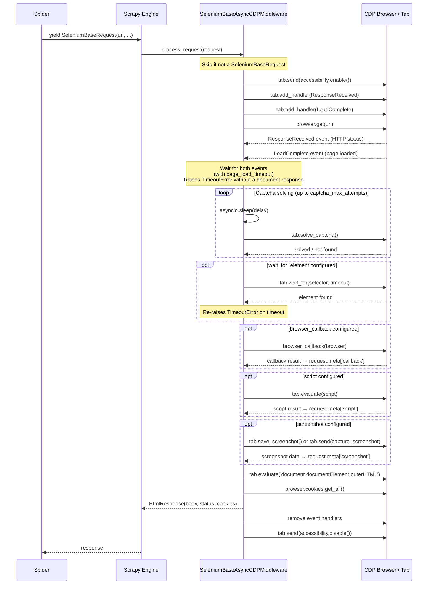

# Architecture

This document describes the internal architecture of `scrapy-seleniumbase-cdp`,
a Scrapy downloader middleware that uses SeleniumBase's pure CDP (Chrome
DevTools Protocol) mode to process requests.

## Request processing sequence

The following diagram shows what happens when the middleware processes a
`SeleniumBaseRequest`:

## Components

### `SeleniumBaseRequest` (`request.py`)

A subclass of Scrapy's `Request` that carries additional configuration for the
middleware. It accepts the following kwargs beyond the standard Scrapy ones:

- **`page_load_timeout`** — seconds to wait for both the HTTP response and page
  load events.
- **`captcha_delay`** / **`captcha_blocked_delay`** — seconds to wait before each captcha solve attempt, for a status outside / inside `captcha_blocked_codes`.
- **`captcha_blocked_codes`** — HTTP status codes that trigger the blocked
  delay.
- **`captcha_max_attempts`** — maximum number of captcha solve attempts.
- **`wait_for_element`** / **`element_timeout`** — CSS selector and timeout for
  waiting on a specific DOM element.
- **`browser_callback`** — an async callback receiving the `Browser` instance.
- **`script`** — JavaScript code to execute on the page.
- **`screenshot`** — screenshot configuration (format, full page, save path).

The `script` argument is normalised to a `ScriptConfig` `TypedDict` via a
`match`/`case` statement. `screenshot=True` is coerced to
`{'format': 'png', 'full_page': True}`.

### `SeleniumBaseAsyncCDPMiddleware` (`middleware_async.py`)

The async Scrapy downloader middleware. It maintains a single shared `Browser`
instance for the lifetime of the spider.

#### Lifecycle

1. **`spider_opened`** — starts the CDP browser via
   `cdp_driver.start_async(**browser_options)`.
2. **`process_request`** — intercepts `SeleniumBaseRequest` instances and
   delegates to the processing pipeline (see diagram above). Regular
   `Request` objects are passed through by returning `None`.
3. **`spider_closed`** — stops the browser.

#### Event-driven page load

After calling `browser.get(url)`, the middleware awaits two `asyncio.Event` objects: one set by the `ResponseReceived` CDP event (which records the HTTP status code) and one set by the `LoadComplete` accessibility event (which signals the page has finished loading). Both handlers keep only the events of the tab's main frame, recognised by its frame id, which Chrome makes equal to the tab's target id. Matching the frame rather than the URL is what lets a redirect, whose only document response is the target page's, record that page's status, and what keeps an iframe's document from overwriting it.

Both events are awaited together with `asyncio.wait_for(timeout=page_load_timeout)`. The status starts unknown (`None`). If the timeout expires after the document response arrived, processing continues with a warning; if no document response arrived, the middleware logs an error and raises `TimeoutError`, so a missing response never passes as a `200`.

#### Captcha solving loop

After page load, the delay is picked once from the recorded HTTP status: `captcha_blocked_delay` for a code in `captcha_blocked_codes`, `captcha_delay` for any other. Each of up to `captcha_max_attempts` attempts sleeps that delay, then calls `tab.solve_captcha()`. The loop stops at the first attempt that finds no captcha; if every attempt finds one, a warning is logged and processing continues. A `captcha_max_attempts` of `0` skips the loop, its warning and its stats.

Each request counts its outcome once in `crawler.stats`: `seleniumbase/response_status_count/<code>` for the recorded status before the loop, `captcha/detected` when the first attempt finds a captcha, then `captcha/solved` when a later attempt finds none or `captcha/unsolved` when every attempt finds one.

The `ResponseReceived` handler stays registered during the loop, so a solved challenge that reloads the page overwrites the recorded status. The status is read again when the response is built, which is why a solved challenge reaches Scrapy with the reloaded page's status instead of the challenge's.

#### Post-load steps

After captcha handling, the middleware executes optional steps in order:

1. **Wait for element** — if the element is not found, saves a full-page screenshot in `request.meta['error_screenshot']` and re-raises `TimeoutError`.
2. **Browser callback** — result stored in `response.meta['callback']`.
3. **Script execution** — result stored in `response.meta['script']`.
4. **Screenshot** — data stored in `response.meta['screenshot']` or saved to
   disk.

#### Error handling

- The `_handle_errors` module-level decorator wraps the callback, script, and
  screenshot methods. It catches exceptions and logs them via the module-level
  logger but does **not** abort the request — partial results are still returned.
- Any other exception leaves `process_request`: the `TimeoutError` of a missing document response or of `wait_for_element` as is (`_wait_for_page_load` and `_wait_for_element` already logged it), anything else after being logged. Scrapy passes it to the downloader middlewares' `process_exception`, where `RetryMiddleware` retries the request if the exception is in `RETRY_EXCEPTIONS` (`TimeoutError` is, as an `OSError`). Once retries run out, the request's `errback` receives it.

### CDP events

- **`ResponseReceived`** (`mycdp.network`) — fired when the browser receives an HTTP response. The middleware keeps `DOCUMENT`-type responses whose `frame_id` is the main frame's and records the last one's status code.
- **`LoadComplete`** (`mycdp.accessibility`) — fired when a document has finished loading. The middleware keeps the one whose `root.frame_id` is the main frame's.

### Browser & Tab (`seleniumbase.undetected.cdp_driver`)

- **`Browser`** — the top-level CDP browser instance, started once per spider.
  Provides `get(url)` for navigation, `cookies` for cookie management, and
  access to `main_tab`.
- **`Tab`** — represents a browser tab. Provides `evaluate()` for JavaScript
  execution, `wait_for()` for element waiting, `solve_captcha()` for captcha
  solving, `save_screenshot()` and `send()` for screenshot capture.
